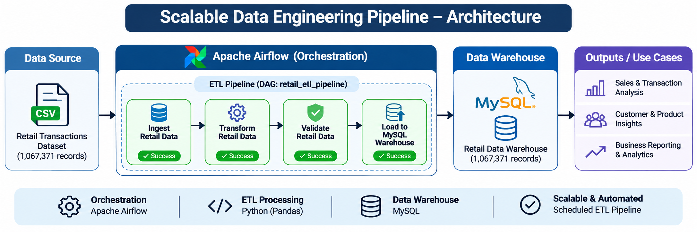
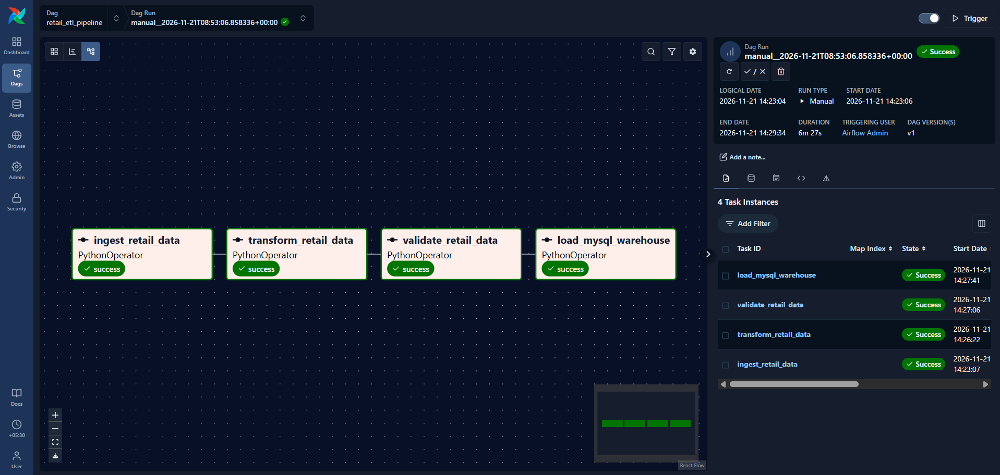
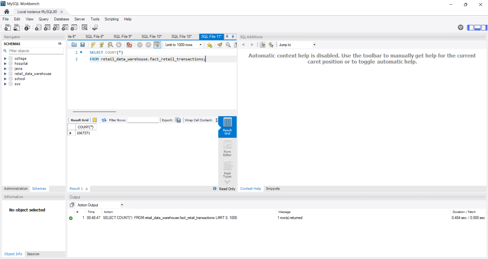

# Scalable Data Engineering Pipeline

An end-to-end data engineering project that builds an automated ETL pipeline using Python, PySpark, MySQL, Apache Airflow, and Docker. The pipeline processes the UCI Online Retail II dataset, performs data transformation and quality validation, and loads processed records into a MySQL data warehouse for analytical queries.

## Project Architecture



## Technologies Used

- Python
- Pandas
- PySpark
- MySQL
- SQL
- Apache Airflow
- Docker & Docker Compose
- Parquet
- Git & GitHub

## Dataset

**UCI Online Retail II Dataset**

- Two Excel worksheets covering 2009–2010 and 2010–2011.
- Combined dataset: 1,067,371 records.
- Transaction-level retail data containing invoices, products, quantities, prices, dates, customers, and countries.

## ETL Pipeline

### 1. Data Ingestion

- Reads both Excel worksheets.
- Combines the datasets.
- Standardizes data types.
- Stores raw data in Parquet format.

### 2. Data Transformation

- Uses PySpark for data processing.
- Renames and standardizes columns.
- Converts data types.
- Calculates transaction revenue.
- Extracts date-related analytical fields.
- Stores transformed data in Parquet format.

### 3. Data Quality Validation

- Checks required columns.
- Identifies missing values.
- Checks zero quantities and negative prices.
- Identifies negative quantities and duplicate records.
- Retains return and cancellation records for analysis.

### 4. Data Warehouse Loading

- Loads transformed records into MySQL.
- Uses batch-based data insertion.
- Stores records in the `fact_retail_transactions` table.

### 5. Workflow Orchestration

Apache Airflow manages the ETL workflow through four sequential tasks:

1. `ingest_retail_data`
2. `transform_retail_data`
3. `validate_retail_data`
4. `load_mysql_warehouse`

The workflow is containerized and executed using Docker Compose.

## Project Screenshots

### Apache Airflow - Successful DAG Execution

All four ETL tasks completed successfully.



### MySQL Data Warehouse Verification

Verified the successful loading of 1,067,371 records into MySQL.



## Data Validation Results

| Metric | Result |
|---|---:|
| Total records | 1,067,371 |
| Missing invoice numbers | 0 |
| Missing stock codes | 0 |
| Missing transaction dates | 0 |
| Missing quantities | 0 |
| Missing unit prices | 0 |
| Missing customer IDs | 243,007 |
| Missing descriptions | 4,382 |
| Negative quantities | 22,950 |
| Negative prices | 5 |
| Duplicate records | 12,133 |

**Validation Status: PASSED**

## SQL Analytics

SQL scripts were developed to analyze:

- Sales and revenue trends.
- Customer segmentation.
- Product performance.
- Country-wise revenue.

### Key Analytical Findings

- Total revenue: 19,287,250.55
- Total products: 5,132
- Total units sold: 10,608,492
- Highest monthly revenue: November 2010 — 1,422,654.64
- Highest revenue country: United Kingdom

## Project Structure

```text
Scalable_Data_Engineering_Pipeline/
│
├── src/
│   ├── ingestion/
│   ├── transformation/
│   ├── validation/
│   └── database/
│
├── tests/
├── data/
│   ├── raw/
│   └── processed/
│
├── sql/
├── dags/
├── screenshots/
├── plugins/
├── logs/
├── config/
│
├── main.py
├── requirements.txt
├── Dockerfile
├── docker-compose.yaml
├── .gitignore
└── README.md
```

## Key Highlights

- Built an end-to-end ETL pipeline.
- Processed over one million retail transaction records.
- Implemented data transformations using PySpark.
- Added data quality validation.
- Designed a MySQL data warehouse.
- Developed SQL analytical queries.
- Orchestrated ETL tasks using Apache Airflow.
- Containerized the application using Docker.

## Project Verification

The complete Airflow DAG executed successfully, with all four tasks marked as successful.

MySQL verification confirmed that the `fact_retail_transactions` table contains **1,067,371 records**.

## Author

**Arjun Ajai**

BSc Computer Science Graduate | Data Science & AI

[GitHub](https://github.com/arjunajai221-a11y)